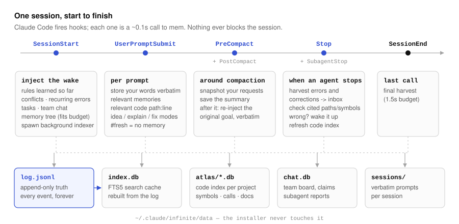
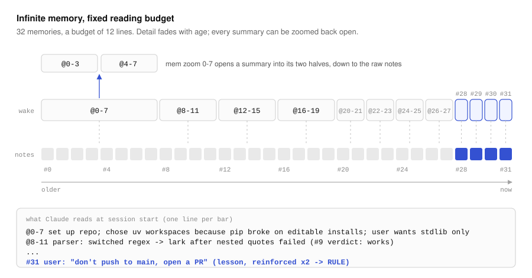
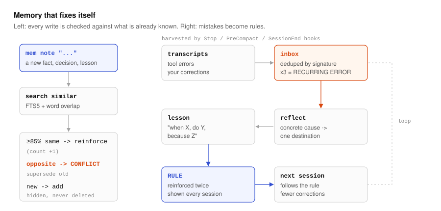
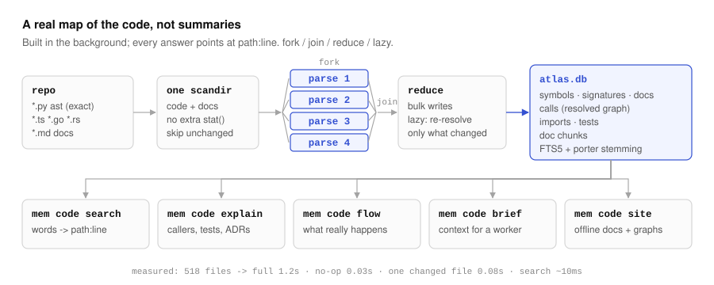
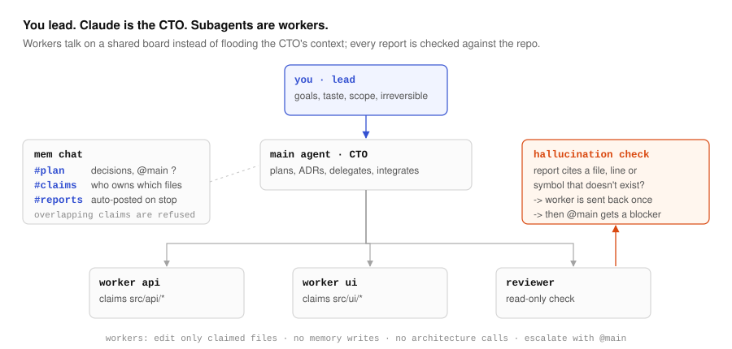

# claude-infinite

**Long-term memory for Claude Code that never forgets, corrects itself, and stays on in every project.**

Pure Python standard library. No server, no dependencies, no API calls from hooks, no telemetry.
Everything lives in plain files on your machine.

```sh
git clone https://github.com/kleeedolinux/claude-infinite.git
cd claude-infinite
python install.py            # idempotent; backs up ~/.claude/settings.json first
```

Then open Claude Code in any folder. That's it: memory is injected automatically and `mem` is on your PATH.

---

## The idea

A Claude Code session starts empty. Whatever was decided yesterday, whatever mistake was corrected
an hour ago, whatever you asked for before the context was auto-compacted is gone unless someone
writes it down and reads it back at the right time.

claude-infinite does that writing and reading for you, with three ideas:

1. **The log is the truth.** Every memory is an event appended to one file. Nothing is ever deleted;
   outdated facts are *superseded* (hidden, kept in history). The search index is just a cache rebuilt from the log.
2. **Infinite memory, fixed budget.** Recent memories are shown word for word, older ones through
   one-line summaries that get coarser with age. Every summary can be zoomed back open, down to the raw notes.
3. **Mistakes become rules.** Tool errors and your corrections are harvested from the transcripts.
   A lesson that comes up twice becomes a RULE that every future session sees first.

---

## How it works

### 1. One session, start to finish



Claude Code fires a *hook* (a small command) at fixed points in a session. Each is a quick call to `mem`
(about 0.1s) that always exits successfully, so a bug in memory can never break your session.

- **SessionStart** injects the *wake*: learned rules, open conflicts, tasks, team chat, and the memory tree.
- **UserPromptSubmit** stores your words verbatim and adds the memories and code locations relevant to that prompt.
- **PreCompact / PostCompact.** When the context is compacted, your original requests are re-injected *verbatim* afterwards,
  so the goal is never paraphrased away.
- **Stop / SubagentStop** harvest errors and corrections, and check the files and symbols the agent cited.

### 2. The memory tree



Notes are leaves. Blocks of 2, 4, 8… neighbouring notes get a one-line summary (a *nap*) that Claude writes when the view needs it.
At wake, the past is tiled with as few lines as the budget allows. Blocks are finest near the present and coarsest far back.
`mem zoom 0-7` descends one level. The tree picture above comes from the real `cover()` function in
`src/infinite/tree.py`.

You never lose detail, you only choose how much of it to read right now.

### 3. Memory that fixes itself



- **At write time.** A near-duplicate reinforces the existing note instead of adding a copy. A note that says the opposite of an
  existing one opens a CONFLICT, which you resolve with `mem supersede`.
- **Over time.** Transcripts are scanned for failed tool calls and for phrases like *"no, you forgot…"* or *"não, errado…"*.
  Repeated errors become a **RECURRING ERROR** alert. `mem reflect` turns the inbox into concrete lessons, and a lesson reinforced
  twice is promoted to a **RULE**.
- **Hallucinations.** When an agent finishes, the paths, `file:line` ranges and code symbols in its answer are checked against
  the repo. A subagent that cites something that doesn't exist is sent back once. After that, the main agent gets a blocker.

### 4. A real map of the code



Every project is indexed in the background into a **code atlas**. Python is parsed exactly with `ast`; JS/TS/Go/Rust approximately.
The atlas stores symbols, signatures, docstrings, calls, imports, tests and doc chunks, with ranked full-text search.

```sh
mem code search "rebuild index"     # -> path:line ranges, graph-expanded
mem code explain rebuild            # what it is, callers, callees, tests, ADRs, source
mem code flow hooks.stop            # what really happens, plus a mermaid diagram
mem code brief "add retries"        # a <=2.6k-char context pack for a subagent
mem code site                       # offline docs site with module and call graphs
```

Indexing is fork/join (parallel parse), then reduce (bulk writes), and it is lazy: only the calls a change can affect are re-resolved.
On a 518-file repo, a full index takes 1.2s, a no-op re-index 0.03s, one changed file 0.08s, and a search about 10ms.

### 5. Many agents, one project



- **Roles.** You are the **lead**: you decide goals, taste, scope, and anything irreversible. The main agent is the **CTO**: it plans,
  writes ADRs, delegates and integrates. Subagents are **workers** with limited rights: they edit only the files they claimed, write no memory,
  make no architecture calls, and escalate questions with `@main`.
- **Chat.** `mem chat` is a small Slack-like board per project, with channels, @mentions, unread cursors and file claims.
  It keeps the CTO's context clean.
- **Reports.** Every subagent report is saved and posted to `#reports` automatically.

---

## Everyday use

You mostly talk to Claude normally. These are the commands Claude (or you) run:

| Command | What it does |
|---|---|
| `mem note "<fact>" -k decision\|fact\|lesson\|pref` | Remember one thing (`-g` for global, about you) |
| `mem recall <words>` | Search memory (`-a` across all projects) |
| `mem supersede <id> "<correct text>"` | Fix a wrong memory; the old one stays in history |
| `mem zoom 0-7` | Open a summary line |
| `mem idea "<idea>"` | Park a mid-task idea in `.claude/TASKS.md` and keep working |
| `mem reflect` | Turn harvested errors and corrections into lessons |
| `mem explain "<question>"` | A grounded explanation pack: concept, then why, then how, with `file:line` |
| `mem adr new "<decision>"` | A decision record linked to the code it affects |
| `mem doctor --fix` | Check and repair everything from the log |

Write `#fresh` in a prompt to make Claude reason without memory first. Idea and decision prompts get an
anti-bias protocol: at least 3 real options, a premortem of the favourite, and memory labelled separately from fresh reasoning.

### Skills and agents installed

- **Skills:** `infinite-memory`, `new-project`, `migrate-project`, `monorepo`, `idea-lab`, `reflect`, `finish-task`, `team`, `explain`, `docs`.
- **Agents:** `memory-curator` (the only subagent that may write memory), `idea-critic`, `project-architect`, `worker`, `reviewer`.

---

## What the installer touches

| Where | What |
|---|---|
| `~/.claude/infinite/` | The code, `config.json`, and `data/` (your memories). Updates never touch `data/`. |
| `~/.claude/CLAUDE.md` | A short block between `infinite-memory` markers; the rest of the file is kept. |
| `~/.claude/settings.json` | 7 hooks and permission to run `mem`. The file is backed up first, and other keys are preserved. |
| `~/.claude/skills/`, `~/.claude/agents/` | The skills and agents above, marked so uninstall removes only these. |
| `~/.local/bin/` | `mem` and `mem.cmd` shims. |

`python install.py --dry-run` shows the plan. `python install.py --uninstall` removes everything except your memories.
Set `INFINITE_HOME` to keep the data somewhere else, for example a synced folder.

### Configuration

Run `mem config key=value`.

| Key | Default | Meaning |
|---|---|---|
| `wake_lines` | 60 | Memory-tree lines per scope at session start |
| `wake_chars` | 9000 | Cap on the session-start context (Claude Code allows 10k) |
| `prompt_chars` / `prompt_hits` | 1800 / 5 | Size of the per-prompt recall |
| `rule_threshold` | 2 | Reinforcements before a lesson becomes a RULE |
| `verify_claims` | true | Hallucination check when agents stop |
| `auto_index` | true | Background code indexing |

---

## Layout

```
src/infinite/
  core.py      event log, index, write decisions, scoring, rules, inbox
  tree.py      summary tree: cover, lazy naps, zoom
  wake.py      session-start context and per-prompt recall
  harvest.py   verbatim prompts, transcript error/correction harvest
  hooks.py     Claude Code hook entry points (always exit 0)
  verify.py    hallucination check
  chat.py      agent team chat and file claims
  atlas.py     code index and graph search
  adr.py learn.py site.py projects.py tasks.py cli.py
skills/ agents/ claude/ install.py tests/ tools/diagrams.py
docs/adr/      why things are the way they are
```

The diagrams in this README are generated by `python tools/diagrams.py`.

## Development

```sh
python -m unittest tests/test_mem.py     # runs against a temporary INFINITE_HOME
python install.py
python tests/live_hooks.py <project>     # exercises the installed hooks
```

The rules for contributors are in `CLAUDE.md` and `docs/adr/`.

## Credits

The following ideas were borrowed and re-implemented; no code was copied:

- [OptMem](https://github.com/VictorTaelin/OptMem) (append-only memory, a binary summary tree, a short prompt).
- [uniichat](https://github.com/VictorTaelin/uniichat) (a zoomable tree that never rots, compaction that keeps the user's words).
- [*Projetos grandes com Claude*](https://joaodavisn.pages.dev/projetos-grandes-com-claude/) (task file, knowledge base with verdicts, closing checklist, saved subagent reports).
- Zep/Graphiti (bi-temporal invalidation), mem0 (write-time add/update/no-op), Generative Agents (recency + importance + relevance),
  and Reflexion (lessons from failures).

## License

[Apache-2.0](LICENSE)
