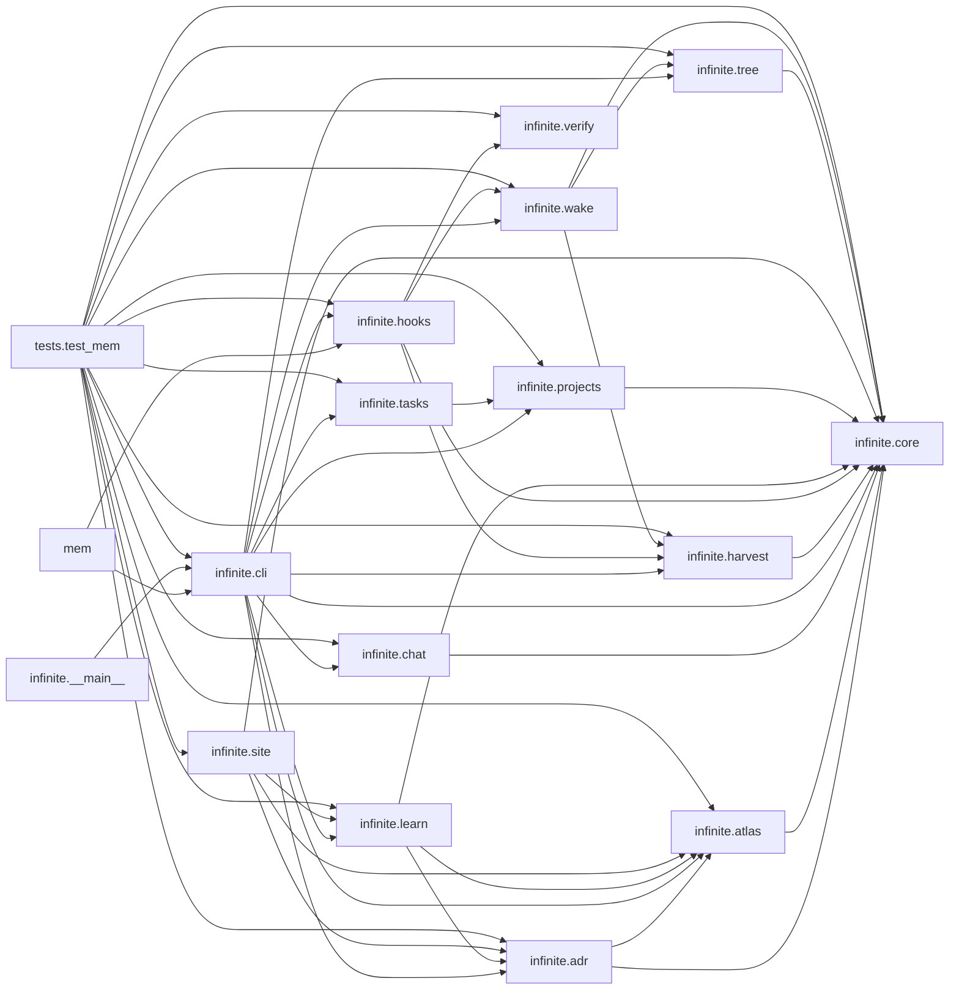

# Architecture

## Overview (human-written)
claudeinfinite gives Claude Code a long-term memory and a map of each codebase. Everything is driven by Claude Code hooks, so it works in every project without anyone having to remember to run it.

**Main flow.**
1. **Session start.** `hooks.session_start` (src/infinite/hooks.py:37) registers the project. It then spawns a detached background indexer for the code atlas and prints the wake document built by `wake.wake` (src/infinite/wake.py:63). That document holds the rules, alerts, tasks, team chat, the atlas line, and the global and project memory trees.
2. **Each prompt.** `wake.prompt_context` (src/infinite/wake.py:150) adds the relevant memories and code locations, plus the explain, idea, parking-lot or correction guidance when the prompt calls for it.
3. **Recording.** Writes go through `core.emit` (src/infinite/core.py:321): one event is appended to `log.jsonl` and applied to the SQLite index. This is ADR-0001: the log is the truth, so the index can always be rebuilt.
4. **Stopping.** The Stop hooks harvest errors and corrections from the transcript and check the final message for hallucinations. `hooks.subagent_stop` (src/infinite/hooks.py:191) applies the same check to workers. Workers have limited rights (ADR-0003).

**Why it is shaped this way.**
- Hooks must never block or slow a session. That is why the code is stdlib-only, every hook exits 0, and indexing runs time-boxed in the background (ADR-0002).
- Memory is split into two parts so it can grow forever while staying within a fixed reading budget:
  - an exact layer: notes, plus FTS5 search over them
  - a zoomable summary layer: `tree.py`
- The code atlas (`atlas.index`, src/infinite/atlas.py:285) is derived from the code, never hand-written. It is the basis for all docs, explanations and subagent briefs.

NOT verified here: performance on repos above roughly 5k source files. The atlas has been measured on 518 files (WOLOS: 2.0s for a full index, 0.08s for an incremental one).

<!-- generated:begin (mem code docs) -->
_Generated from the code index on 2026-11-01. Do not edit inside these markers._

# Code map: claudeinfinite
20 files, 248 symbols. Languages: python 20 files/4653 loc

## Modules
- `install.py` (install, 206 loc, 11 symbols) — Install claudeinfinite globally for Claude Code (idempotent; rerun to update). python install.py install / upd
- `mem.py` (mem, 18 loc, 0 symbols) — Launcher: python mem.py <command>. Works from a checkout or ~/.claude/infinite.
- `src/infinite/__init__.py` (infinite, 3 loc, 0 symbols) — claudeinfinite: infinite, self-correcting memory for Claude Code.
- `src/infinite/__main__.py` (infinite.__main__, 4 loc, 0 symbols)
- `src/infinite/adr.py` (infinite.adr, 125 loc, 8 symbols) — Architecture Decision Records in docs/adr/NNNN-slug.md (MADR-style), linked to code. Each ADR names what it `a
- `src/infinite/atlas.py` (infinite.atlas, 851 loc, 35 symbols) — Code atlas: a real, queryable model of a codebase (not prose). Index (per project, data/atlas/<scope>.db, incr
- `src/infinite/chat.py` (infinite.chat, 148 loc, 10 symbols) — Team chat for agents (Slack-like), per project: channels, @mentions, per-agent unread cursors, file claims (ow
- `src/infinite/cli.py` (infinite.cli, 647 loc, 41 symbols) — `mem` — infinite memory for Claude Code. Run `mem help`.
- `src/infinite/core.py` (infinite.core, 525 loc, 37 symbols) — Core store: append-only event log (truth) + SQLite FTS5 index (rebuildable cache). Design (borrowed and merged
- `src/infinite/harvest.py` (infinite.harvest, 160 loc, 10 symbols) — Session state + transcript harvesting (no LLM calls; pure heuristics). - Session state keeps the user's words 
- `src/infinite/hooks.py` (infinite.hooks, 248 loc, 15 symbols) — Claude Code hook entry points. Every hook fails silent (exit 0) — memory must never block a session. Errors go
- `src/infinite/learn.py` (infinite.learn, 176 loc, 11 symbols) — Glossary + learner profile + explain packs. The glossary explains what a thing IS (concept), not just the code
- `src/infinite/projects.py` (infinite.projects, 383 loc, 11 symbols) — Projects: scaffold new ones, scan/migrate existing ones, plan monorepos, import Claude Code's own memory files
- `src/infinite/site.py` (infinite.site, 143 loc, 1 symbols) — Static, offline, single-file docs site generated from the atlas + ADRs + glossary + memory. `mem code site [ou
- `src/infinite/tasks.py` (infinite.tasks, 131 loc, 10 symbols) — TASKS.md (In progress / Queue / Done) and docs/kb records, per joaodavisn's "projetos grandes com Claude": con
- `src/infinite/tree.py` (infinite.tree, 163 loc, 12 symbols) — Summary tree per scope (OptMem / uniichat). Leaves are notes in scope order (pos). Block [lo,hi) is an aligned
- `src/infinite/verify.py` (infinite.verify, 153 loc, 4 symbols) — Hallucination capture: check an agent's final message against the real repo. Checks (cheap, no LLM): - cited p
- `src/infinite/wake.py` (infinite.wake, 208 loc, 4 symbols) — What the agent sees: the wake document and the per-prompt recall.
- `tests/live_hooks.py` (tests.live_hooks, 35 loc, 1 symbols) — Live check of the INSTALLED hooks (~/.claude/infinite), as Claude Code runs them. Usage: python tests/live_hoo
- `tests/test_mem.py` (tests.test_mem, 326 loc, 27 symbols)

## Entry points
- install  install.py:1-205
- install.main  install.py:187-201
- infinite.cli  src/infinite/cli.py:1-646
- infinite.cli.main  src/infinite/cli.py:631-642
- infinite.hooks.run  src/infinite/hooks.py:232-247
- tests.test_mem  tests/test_mem.py:1-325

## Internal dependencies (module -> module)
- mem -> infinite.hooks
- mem -> infinite.cli
- infinite.__main__ -> infinite.cli
- infinite.adr -> infinite.core
- infinite.adr -> infinite.atlas
- infinite.atlas -> infinite.core
- infinite.chat -> infinite.core
- infinite.cli -> infinite.core
- infinite.cli -> infinite.harvest
- infinite.cli -> infinite.projects
- infinite.cli -> infinite.tasks
- infinite.cli -> infinite.tree
- infinite.cli -> infinite.wake
- infinite.cli -> infinite.chat
- infinite.cli -> infinite.atlas
- infinite.cli -> infinite.adr
- infinite.cli -> infinite.learn
- infinite.cli -> infinite.hooks
- infinite.harvest -> infinite.core
- infinite.hooks -> infinite.core
- infinite.hooks -> infinite.harvest
- infinite.hooks -> infinite.wake
- infinite.hooks -> infinite.verify
- infinite.learn -> infinite.core
- infinite.learn -> infinite.atlas
- infinite.learn -> infinite.adr
- infinite.projects -> infinite.core
- infinite.site -> infinite.adr
- infinite.site -> infinite.atlas
- infinite.site -> infinite.core
- infinite.site -> infinite.learn
- infinite.tasks -> infinite.projects
- infinite.tree -> infinite.core
- infinite.wake -> infinite.core
- infinite.wake -> infinite.tree
- infinite.wake -> infinite.harvest
- tests.test_mem -> infinite.cli
- tests.test_mem -> infinite.core
- tests.test_mem -> infinite.harvest
- tests.test_mem -> infinite.hooks
- tests.test_mem -> infinite.projects
- tests.test_mem -> infinite.tasks
- tests.test_mem -> infinite.tree
- tests.test_mem -> infinite.wake
- tests.test_mem -> infinite.atlas
- tests.test_mem -> infinite.adr
- tests.test_mem -> infinite.learn
- tests.test_mem -> infinite.site
- tests.test_mem -> infinite.verify
- tests.test_mem -> infinite.chat

## Most-called (hubs)
- infinite.core.db  src/infinite/core.py:202  (44 call sites)
- infinite.atlas.exists  src/infinite/atlas.py:76  (35 call sites)
- infinite.cli.build.add  src/infinite/cli.py:563  (35 call sites)
- infinite.core.scope_key  src/infinite/core.py:136  (19 call sites)
- infinite.atlas._rows  src/infinite/atlas.py:488  (18 call sites)
- infinite.core.get  src/infinite/core.py:427  (17 call sites)
- infinite.projects._write  src/infinite/projects.py:160  (17 call sites)
- infinite.core.find_root  src/infinite/core.py:141  (16 call sites)
- infinite.core.note  src/infinite/core.py:362  (16 call sites)
- infinite.core.fmt  src/infinite/core.py:508  (16 call sites)
- infinite.atlas.adb  src/infinite/atlas.py:63  (15 call sites)
- infinite.cli._scope  src/infinite/cli.py:43  (14 call sites)

## Most complex
- infinite.atlas.explain  src/infinite/atlas.py:644-697  complexity 40
- infinite.verify.check  src/infinite/verify.py:92-152  complexity 39
- infinite.atlas.brief  src/infinite/atlas.py:700-755  complexity 37
- infinite.wake.wake  src/infinite/wake.py:63-142  complexity 35
- infinite.atlas.parse_python  src/infinite/atlas.py:114-174  complexity 33
- infinite.atlas._resolve  src/infinite/atlas.py:428-483  complexity 32
- infinite.atlas.parse_python.visit  src/infinite/atlas.py:122-171  complexity 31
- infinite.wake.prompt_context  src/infinite/wake.py:150-207  complexity 31
- infinite.harvest.harvest  src/infinite/harvest.py:94-139  complexity 29
- infinite.atlas.index  src/infinite/atlas.py:285-348  complexity 28
- infinite.atlas.search  src/infinite/atlas.py:515-575  complexity 28
- infinite.cli.cmd_code  src/infinite/cli.py:431-477  complexity 26

## Public symbols with no direct test call (136 of 173)
- install.say  install.py:39-40
- install.py  install.py:43-44
- install.hook_cmd  install.py:47-48
- install.copy_code  install.py:51-62
- install.copy_assets  install.py:73-98
- install.claude_md  install.py:101-112
- install.settings  install.py:115-152
- install.shims  install.py:155-174
- install.post_install  install.py:177-184
- install.main  install.py:187-201
- infinite.adr.adr_dir  src/infinite/adr.py:37-38
- infinite.adr.parse  src/infinite/adr.py:45-55

## Module graph

<!-- generated:end -->
